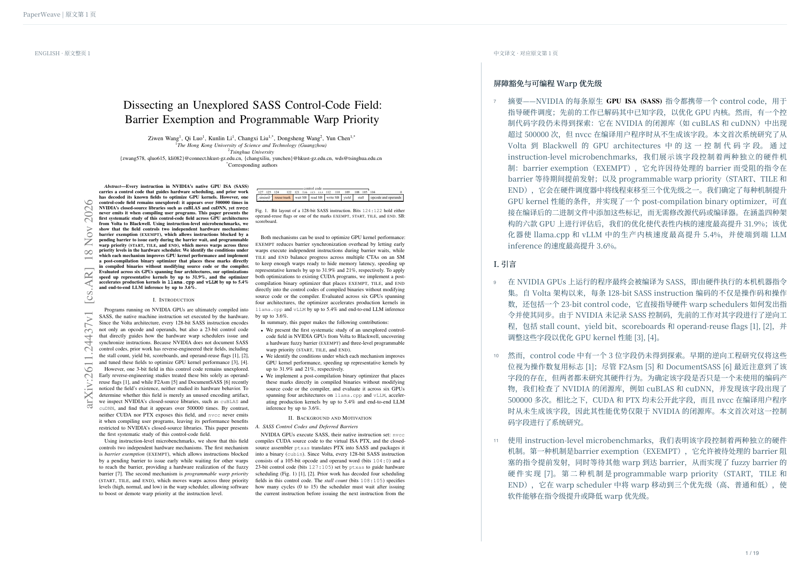

# PaperWeave · 论文织译

在 Zotero 中生成「**左侧英文原页 60% / 右侧中文译文 40%**」的论文对照 PDF。支持大模型逐段翻译、术语保留、译文修订和重新生成阅读副本。

适用于 **Zotero 10**，目前为 Alpha 预览版。

[下载与安装](#安装与升级) · [反馈问题](https://github.com/alan-hpc/zotero-paper-weave/issues) · [更新记录](CHANGELOG.md)



实际输出示例：[Dissecting an Unexplored SASS Control-Code Field](https://arxiv.org/abs/2611.24437)。译文较长时会增加续页，并重复显示对应原文页。

## 安装与升级

当前源码版本为 **[0.1.0-alpha.49](docs/releases/v0.1.0-alpha.49.md)**。启用自动检查后，无需逐段人工确认：自动修复算法分组、识别和重译疑难正文；仍无法确认的区域在对应位置保留原文图像，继续生成 PDF。已有译文和人工修订保留。已通过自动检查与 DistMoE 隔离副本实测，尚未在当前 Zotero 安装。

1. 打开 [GitHub 构建列表](https://github.com/alan-hpc/zotero-paper-weave/actions/workflows/build.yml)，选择 main 分支最新通过的构建，在 **Artifacts** 中下载 `paperweave-build` 并解压。下载构建产物需要登录 GitHub；也可按下文从源码构建。
2. 在 Zotero 中打开「**工具 → 插件 → 齿轮 → 从文件安装插件**」，选择解压后的 `.xpi`。
3. 重启 Zotero。升级后原有模型配置、译文和人工修订继续保留。

[Releases](https://github.com/alan-hpc/zotero-paper-weave/releases) 当前最新公开安装包为 **alpha.37**，尚未发布 alpha.49 Release。本页使用说明以 alpha.49 为准。Alpha 版本需手动安装升级。

## 第一次翻译

1. 选中一个 **PDF 附件**或包含 PDF 的论文条目，右键选择「**PaperWeave · 逐段双语 PDF / 修订**」。
2. 展开「**模型与翻译偏好**」，启用需要的服务并填写下表配置。
3. 点击「**保存全部设置**」，再点击「**翻译并生成 PDF**」。插件会识别本文术语、逐段翻译、保存进度并生成 PDF 附件。
4. 在 Zotero 中阅读新 PDF。勾选「**生成后优先打开双语 PDF**」时，它会成为这篇论文优先打开的附件，原始 PDF 仍保留。

| 设置 | DeepSeek API | 本机 Codex 代理 |
| --- | --- | --- |
| Base URL | `https://api.deepseek.com/v1` | `http://127.0.0.1:47771/v1` |
| 模型 | 账户支持的模型，例如 `deepseek-flash` | `codex-local`，或账户可用的具体模型 ID |
| API Key | 填写 DeepSeek Key | 留空 |
| 前置操作 | 准备 API 账户和 Key | 在官方 Codex CLI 中使用 ChatGPT 登录，并启动配套代理 |

**只用 DeepSeek 即可使用插件**：仅启用 DeepSeek，其他服务可以停用或留空。使用 Codex 时，翻译期间需保持本机代理运行，见 [Codex 配置指南](docs/CODEX_PROXY.zh-CN.md)。也可启用「其他兼容 API」，填写兼容 Chat Completions 的接口。

服务按**从上到下的优先级**调用，用「上移 / 下移」调整后保存。未启用或配置不完整的服务会跳过。勾选「**额度耗尽时按顺序切换到下一可用服务**」后，明确的额度或余额耗尽才会触发切换；普通排队、临时限速和网络错误仍在原服务有限重试。下一服务可能按其账户计费。

## 修改译文与继续翻译

- **修订**：右键打开原 PDF 或生成的 PDF，选择段落，修改「中文译文」，点击「**保存修订**」。
- **更新阅读副本**：再次点击「**翻译并生成 PDF**」。已有译文复用缓存，每次生成新附件；人工修订保留。
- **失败后继续**：再次点击主按钮，复用已保存的段落与恢复句组，继续未完成部分。已采用识别的译文保护错误会进入来源绑定恢复，具体机制见 [完整恢复方案](docs/TRANSLATION_RECOVERY.zh-CN.md)。疑难原文按下文自动处理。
- **识别已采用、译文仍校验失败**：保留识别原文，只处理失败句组；必要时按完整句子逐句恢复，保存成功进度后继续。多写、漏写或错误引用仍会阻止保存，不通过删除公式或接受不合格译文来放行；启用自动检查后，最终仍不可靠的区域明确按原文保留。
- **主窗口关闭后继续**：工作台仍可读取字体、截图和生成 PDF；需要时会打开原 PDF 的独立阅读窗口。网络恢复后再次点击主按钮继续，已保存进度复用。
- **旧译文中的单词黏连**：升级后按原 PDF 字形更新兼容的空格边界，受影响的旧译文标记待核对。使用「重译需复核段落（保留人工修订）」处理；原译文保留到新结果通过校验，人工修订不会自动覆盖。
- **修改术语**：在「**本文术语表**」增删需要保留英文的词，再按需重新翻译相关段落。修改词表或切换模型不会自动重译已有译文。
- **重译一段**：「**重新翻译本段（覆盖）**」会替换该段译文，包括人工修订，请按需使用。

译文内容在 PaperWeave 工作台修订；Zotero 阅读器用于阅读、高亮和批注。**旧 PDF 的批注不会自动迁移到新附件。**

## 自动处理公式与疑难段落

勾选主按钮下方「**生成 PDF 前，自动检查并修复疑难段落（无需人工确认）**」，再点击「**翻译并生成 PDF**」。所选模型需支持图片输入；本机 Codex 使用 alpha.43 或更新的配套代理。

- 先按本地版面修复算法、图表和正文归属。完整算法连同阶段标题、所有步骤和数学表达整组保留原貌。
- 对疑难正文自动读图，检查英文、数字、公式、类型和样式；出错时带具体诊断复查。必要时增加原文公式局部高清图，再自动重译和校验。
- 有限自动恢复后仍无法确认时，在右栏对应位置保留完整原文图像，并在 PDF 与任务结果中说明。已有中文留在可编辑项目中，**不会把未通过检查的译文当作合格结果**；不等待逐段确认。
- 已完成决定保存后复用，反复点击不会无限重试。网络、额度、登录、磁盘或生成错误仍保留进度并显示错误，恢复服务后继续；这类故障不会伪装成内容已处理。
- 人工修订保留；需要时仍可在工作台修改中文或识别原文。手动修改、重译成功或原文区域变化后，相关自动保留决定会重新检查。图片上传默认关闭，其他用户须自行启用。

截图只发送给当前选定的图片模型，不会因失败转发到其他服务。详见 [自动识别与可选修订](docs/VISION.zh-CN.md)、[算法与数学结构处理](docs/DOCUMENT_STRUCTURE.zh-CN.md)。

旧 PDF 中公式括号或字母出现尖刺、拖影时，升级后重新生成 PDF 即可应用矢量绘制修复，无需更换字体或重复识别。

## 阅读效果与使用边界

- **版面**：左侧保留完整原页，右侧按原文顺序排译文，中间竖线分隔。正文两端对齐，段末左对齐；正文与英文术语使用宋体，行内代码使用等宽字体。
- **原文内容**：图表、图注、表格、算法和独立公式整组保留原貌；行内公式支持 LaTeX 排版。作者、单位、邮箱等信息仅保留在左侧原页。
- **技术术语**：逐篇识别并保留英文，可在本文词表中修正。版面提取和模型识别可能出错，需对照原文复核。
- **工作台**：同一时间使用一个窗口。空闲时打开另一篇论文会先保存再切换；处理期间会提示等待或取消。
- **备份**：译文项目默认保存在本机，不随 Zotero 同步；可用「导出修订项目」备份。
- **PDF 支持**：扫描件需先 OCR；加密或旋转页面暂不支持。
- **数据发送**：翻译会向所选服务发送论文文本；图片识别会发送目标段落截图，使用对应服务的额度。插件不上传整篇 PDF，Key 保存在 Zotero 凭据管理器中，见 [隐私说明](docs/PRIVACY.md)。

## 从源码构建

需要 Node.js 20.10+：

```sh
git clone https://github.com/alan-hpc/zotero-paper-weave.git
cd zotero-paper-weave
npm ci
npm run build
```

安装包在 `dist/*.xpi`。需要 Codex 代理时可运行 `npm run proxy:codex`，再按上表配置。

开发检查：`npm run typecheck`、`npm test`。更多内容见 [架构说明](docs/ARCHITECTURE.md)、[参与开发](CONTRIBUTING.md)和[后续计划](docs/ROADMAP.md)。

## 许可证

源码使用 [MIT](LICENSE) 许可证；字体和依赖保留各自许可，见 [第三方声明](THIRD_PARTY_NOTICES.md)。本项目独立开发，与 Zotero 官方无隶属关系。
