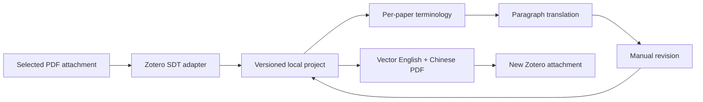

# Architecture

## Pipeline

## Boundaries

The bootstrap registers a chrome UI and a controller. The controller is the only module that
writes Zotero preferences, reads Login Manager entries, accesses project files, or imports attachments.
It does not write `zotero.sqlite`. The workbench uses an explicit controller bridge.

`extract.ts` is the host integration boundary. It requests `Zotero.SDT.getReader()` and materializes
schema major version 1. Node types, `anchor.pageRects`, flow classes, reference flags and part links
produce a normalized `Project`. Unsupported versions, missing coordinates and rotated pages fail
explicitly. This API requires Zotero 10 and must be revisited if host versions change.

`provider.ts` implements Chat Completions with explicit HTTPS endpoints, localhost exceptions,
no redirects, 120-second request timeout, cancel support, and bounded retries for rate limits and
transient HTTP errors. API bodies are not copied to user errors. Paper text is labeled as untrusted
data. Model JSON and terminology placeholders are checked before saving.

`render.ts` never retypes English. It clips and embeds the original PDF page content with pdf-lib,
then draws the corresponding Chinese paragraph with an embedded OFL font. Protected blocks are
embedded once without translation. An optional full-source appendix guards against extraction
omissions. It does not preserve source annotations in clipped snippets.

## Project schema 1

- `source`: library/key/hash/title, binds the project to a specific source PDF.
- `pages`: PDF user-space bounds and host extraction metadata.
- `blocks`: stable IDs derived from SDT refs, source text, source rectangles, classification,
  translation, manual edit flag, and translation model/prompt provenance.
- `terms`: exact source phrases to preserve; no global hard-coded field vocabulary.
- `terminologyReady`: distinguishes an intentionally empty glossary from one not yet generated.
- `outputs`: generated attachment keys and creation times.
- `schema`, `pluginVersion`, `created`, `updated`: format evolution and provenance.

Projects are stored by source key and hash. Writes use a temporary file then replacement. Saves
from one window are serialized. A window registry and per-source job lock prevent duplicate work.
Imports apply edits to current blocks after hash/ID/source-text checks; imported coordinates and
paths never replace the current source layout. No API keys are serialized.

## Revision semantics

Batch translation only fills empty translatable blocks. Manual text persists across rebuilds.
Explicit single-block retranslation overwrites that block. Changing a glossary does not invalidate
or silently retranslate earlier human edits. New PDFs are added as new attachments, and an output
index maps them back to their original project on the same machine. Old PDF annotations remain
on old attachments. Automatic migration of annotation positions is outside this alpha.

## Extension points

1. Keep new provider adapters separate from Zotero storage. Add explicit capability metadata before
   using provider-specific response formats or reasoning flags.
2. Add renderer modes against the same normalized project; translation cache remains reusable.
3. Add schema migrations before changing stored block IDs or rectangle conventions.
4. Add a source-page review canvas for correction of host segmentation and missing graphics.
5. Treat OCR and alternate structure engines as independent extractors with provenance.
6. A future reader extension can link a rendered block marker to its project ID and edit window.
7. Add opt-in backup/sync of project files; never place credentials in a syncable document.

## Current engineering limits

No in-app runtime validation has been performed for this release. Host API availability, privileged
window loading, clipped-vector text selection, library permissions, cancellation during extraction,
and generated PDF layout need real Zotero validation before a stable release. The development
workflow currently performs type checking and builds only; the repository contains no test suite.
