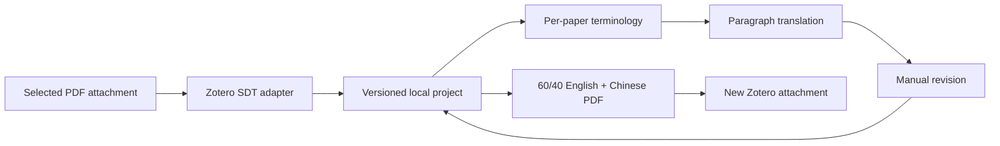

# Architecture

Binary values crossing Gecko compartments are cloned into the consuming global
before inspection. `bytes.ts` preserves typed-view offsets and returns an owned
copy; Xray waivers are reserved for the PDF.js object interface. The controller
clones storage inputs locally, clones PNG/PDF outputs into the IOUtils global,
and exposes a structured-clone bridge for source PDFs and fonts consumed by the
workbench. Screenshot Blob ArrayBuffers and packaged-font responses follow the
same rule. Strings and paragraph metadata do not require this binary bridge.

## Pipeline

## Boundaries

`visionCapture.ts` uses the controller-bound source PDF and `snippets.ts` offscreen print rendering
to produce bounded paragraph PNGs, cached privately under a source/rectangle-specific identifier.
`vision.ts` validates the image/page binding and requests structured English/LaTeX from the configured
provider selected by the service priority list or the active task's quota transition. Vision requests
use explicit inline images, provider-compatible detail, bounded retries and no cross-provider fallback.
Default-off automation runs before PDF generation and in selective review repair. The local Codex
proxy validates inline PNGs, creates private temporary attachments and passes them through the CLI's
image argument while keeping agent tools disabled; no remote URL or client path is dereferenced.
Recognition is a separate, versioned source layer: canonical SDT text/geometry stays intact,
adoption precedes translation, and `translationVisionKey` prevents mixing drafts with different
recognition versions. The workbench supports local preview, editable OCR candidates, explicit
adoption/restoration and selective review repair that excludes manual translations. Recognized
LaTeX reuses the local renderer; no model-proposed coordinates replace trusted source geometry.

The bootstrap registers a chrome UI and a controller. The controller is the only module that
writes Zotero preferences, reads Login Manager entries, accesses project files, or imports attachments.
It does not write `zotero.sqlite`. The workbench uses an explicit controller bridge.
All entry points share one workbench window. A pending-opening promise serializes concurrent
requests; later opens restore and focus the existing window without changing its paper or task.
A lifecycle token prevents old asynchronous item lookups from opening a window after shutdown.
Closing the top-level document releases the slot; child-document unload events do not.

`extract.ts` is the host integration boundary. It requests `Zotero.SDT.getReader()` and materializes
schema major version 1. Node types, `anchor.pageRects`, flow classes, reference flags and part links
produce a normalized `Project`. Unsupported versions, missing coordinates and rotated pages fail
explicitly. This API requires Zotero 10 and must be revisited if host versions change.
`proseGroups.ts` derives ownership for a body/inline-math/continuation sequence only when their
source rectangles overlap on the same text line and the continuation shares the paragraph column.
Stored blocks, words and coordinates stay intact. The OCR source and crop include the complete
group; its member fingerprint participates in recognition binding. Accepted group translation is
emitted once, and manual wording keeps established ownership unless classification is overridden.
Protected semantic types take precedence over auxiliary flow flags: a `math` node remains a
formula even when SDT labels it auxiliary. `upgrade.ts` reconciles refreshed metadata by source
identity and normalized text, allowing safe keep-to-math repairs without discarding translations.
`formatting.ts` recovers matching or structurally corresponding run-in labels from saved text.
`mathRecognition.ts` derives complete mathematical islands and precise source glyph rectangles from
SDT leaf text maps, including scripts, stacked layouts and italic leaf boundaries. Logical-run bounds
are not accepted as exact glyph widths. Each object records source offsets, rectangles, font size,
baselines, recognition features and a source/review representation. These are geometry confidence
checks, not proof of mathematical semantics. Source text maps also recover layout hyphens.
`inlineMath.ts` protects complete objects before terminology processing, matches maximal legacy
aliases with ambiguity rejection, and preserves authored LaTeX. `mathText.ts` maintains reversible
UTF-16 offsets during conservative compatibility normalization. See [Math pipeline](MATH_PIPELINE.md).

`provider.ts` implements Chat Completions with explicit HTTPS endpoints, localhost exceptions,
no redirects, 120-second request timeout, cancel support, and bounded retries for rate limits and
transient HTTP errors. API bodies are not copied to user errors. Paper text is labeled as untrusted
data. Model JSON and terminology placeholders are checked before saving.

`frontMatter.ts` identifies compact author names, affiliations, contacts and author notes on the
first page using text and page context, excluding the title and abstract/body region. Extraction
and cached-project loading apply the same classification, retain stable IDs/source/translated text,
and respect explicit user classification. These regions remain on the intact left page and are
omitted from translation and right-column prose. They remain figure-crop barriers, so excluding
them cannot expand adjacent figure recovery into the author band.
One immutable placeholder per complete formula is validated for exact occurrence count, then restored
with explicit `translationMathRefs`; model reordering does not change formula identity. Failed marker
repair cannot overwrite a cached translation. Imports rebase bindings against current source objects.
The provider emits request waiting/retry states without response bodies or credentials. The workbench keeps a one-second display timer and shows per-stage completed counts in a sticky panel; the timer is cleared when the job finishes or the window unloads.
Transport failures and interrupted JSON bodies use the same bounded attempt budget as transient
HTTP statuses; caller cancellation bypasses retries. Display timers reset on phase/attempt changes.

`settings.ts` migrates the legacy endpoint to independent Codex/DeepSeek/custom profiles and
whitelists persisted configuration fields; keys remain scoped to endpoint realms in Login Manager.
One Provider instance shares a quota-triggered switch across terminology and paragraph workers.
Only explicit Codex quota codes initiate configured DeepSeek fallback. Subsequent requests remain
on DeepSeek for that task; a new task retries the primary. Response ownership is tracked per result,
so a late primary success retains correct provenance. Missing fallback credentials, cancellation and
failed fallback requests do not oscillate between services or overwrite cached revisions.

The optional `scripts/codex-proxy.mjs` helper adapts loopback Chat Completions requests to official
`codex exec` tasks under saved ChatGPT login. It drops API-key environment overrides, uses an empty
temporary directory and structured output, disables unrelated tools, and delivers only a completed
turn plus validated final JSON. It limits concurrency/queueing and propagates client cancellation.
PaperWeave still owns all glossary/math protection and cache writes; the helper never opens projects.
The `codex-local` model name is a default alias; an explicit model field passes through to the CLI
and overrides the helper default, following the same UI configuration pattern as other providers.
See [Setup](CODEX_PROXY.zh-CN.md).

`protection.ts` owns one flat registry per paragraph. Source math, authored TeX, code and literal
marker regions merge in original coordinates; later detectors see only unprotected prose. Namespaces
bind markers to paragraph identity/source, with collision checks against literal input. Input marker
counts and generated emphasis are checked before requests. Responses normalize protocol characters
only, recover expanded values conservatively, and reject missing, repeated, unknown or malformed
markers. A single left-to-right restore updates math/bold offsets without scanning inserted values.
See [Protection protocol](PROTECTION_PROTOCOL.md).

`render.ts` embeds each complete original PDF page in the English 60% panel. This preserves
the source page's columns, headings, equation placement, figures, tables, captions and page layout.
Editable Chinese paragraphs appear in the 40% panel grouped by their source page and kept in the
extracted reading order. Display-math blocks are cropped from the source page and inserted between
the corresponding translated paragraphs. `graphics.ts` groups panels, auxiliary labels and captions
by source page and numbered caption boundaries. The complete source rectangle is placed as one unit,
with a continuation page used when it cannot fit; overlapping regions are not rendered twice.
When vector graphics lack image nodes, numbered captions and adjacent non-auxiliary text bound
their complete source band. Isolated auxiliary labels and stale diagram coordinates are excluded.
Bold source spans are sent as formatting markers and
reapplied to the translated spans. Long translations or formulas create continuation pages that
repeat the matching original page. Figures, captions and tables retain their source appearance in both
columns; code and reference blocks remain in the original page. Chinese body text is justified at CJK boundaries; paragraph endings stay left aligned.
`lists.ts` normalizes structural list markers and offsets emphasis ranges. Rendering draws one
marker outside justified item prose and uses a hanging indent, including on continuation pages.
Legacy repeated prefixes are removed for rendering only; cached translation wording is retained.
Headings are not justified. Translations and English technical terms use the bundled serif face;
explicit inline-code runs use the bundled monospace face. Missing glyphs fall back to the other font
without replacing characters. Term protection is independent of typography.
`latex.ts` converts common TeX/AMS expressions through bundled MathJax into SVG paths, then writes
the paths as PDF vectors. The engine has no autoload, external image or network package support.
PDF-derived inline math is clipped from shared original-page XObjects, preserving source fractions,
accents, scripts and fonts. Each complete source formula or authored LaTeX run wraps as one unit;
line ascent and descent account for its full bounds. Formula internals are never justified.
Each native region retains its relative geometry, including non-text strokes. Physical source-line
wraps carry `flow: wrapped` and rejoin horizontally using per-region baselines; intrinsic matrix or
fraction layout remains one intact source region. Required layout hyphens retain original glyphs.
Uncertain correspondence/coordinates and source math requiring more than 2x downscaling fall back
to the original paragraph with a review notice while the saved Chinese remains editable. Only an
explicit user revision accepts manually authored TeX as a replacement for missing source objects.
The workbench reports math counts and review blocks. Native source resources are embedded once
and reused for original pages, formulas, figures and fallback paragraphs.
The workbench generates comparison pages only, with no full-source appendix. Source annotations
are not copied into the embedded pages; the original Zotero attachment remains available.

`preferred.ts` persists per-paper output attachment keys in local preferences. While enabled it
wraps `Item.getBestAttachments`, reorders only a valid selected PDF belonging to the same parent,
and clears the host best-attachment cache. The native method is restored on shutdown; no dates,
URLs, original files or database tables are rewritten. Missing targets fall back to native order.
The preference is local and is not synced across devices.

## Project schema 1

- `source`: library/key/hash/title, binds the project to a specific source PDF.
- `pages`: PDF user-space bounds and host extraction metadata.
- `blocks`: stable IDs derived from SDT refs, source text, source rectangles, classification,
  translation, manual edit flag, and translation model/prompt provenance.
  Optional `mathSpans` bind complete source objects to glyph geometry; `translationMathRefs` bind
  translated ranges to those objects. Extraction v8 and prompt v8 remain schema-1 compatible.
- `terms`: exact source phrases to preserve; no global hard-coded field vocabulary.
- `terminologyReady`: distinguishes an intentionally empty glossary from one not yet generated.
- `terminologyBatches`: optional fingerprinted results for each completed terminology request;
  older schema-1 projects without this field remain valid and gain resumable checkpoints on analysis.
- `outputs`: the active generated attachment key, creation time and last-update time; historical arrays are consolidated on successful generation.
- `schema`, `pluginVersion`, `created`, `updated`: format evolution and provenance.

Projects are stored by source key and hash. Writes use a temporary file then replacement. Saves
from one window are serialized. A window registry and per-source job lock prevent duplicate work.
Imports apply edits to current blocks after hash/ID/source-text checks; imported coordinates and
paths never replace the current source layout. No API keys are serialized.

## Revision semantics

Batch translation only fills empty translatable blocks and runs at most three paragraph requests at
once. Each completed paragraph is saved immediately. Exhausted paragraph-local protection errors
remain pending while other paragraphs finish and save; the workbench reports IDs and prevents an
incomplete PDF. Resumption only requests pending paragraphs. Validation failure records remain
source-local, and opt-in image repair can process failed blocks. Uncertain recognition still holds
the primary workflow before PDF generation. A higher-resolution capture revision retries old
unresolved candidates without relaxing numeric or uncertainty checks. Network, configuration,
persistence and other failures stop new scheduling while in-flight work can finish; cancellation
aborts requests.
Manual text persists across rebuilds.
Explicit single-block retranslation overwrites that block. Changing a glossary does not invalidate
or silently retranslate earlier human edits. The first PDF is imported as a stored attachment. Later generations validate PDF bytes, reuse the
same attachment key/title/path, atomically replace the file and mark it for upload through Zotero
APIs. A process-wide queue serializes file/provenance/cleanup mutations. File and metadata failures
restore the prior copy; only after commit are other proven PaperWeave outputs under the same parent
trashed recoverably. Standalone sources are isolated. Titles alone never establish ownership.
The reverse output index maps the retained attachment to the current original source revision.
The chosen attachment retains its annotation records; duplicate annotations remain with the trashed
attachments. Reflow can shift annotation locations; automatic remapping is outside this alpha.
Search caches and open readers are refreshed after commit; refresh failures are reported separately.

An explicit full-retranslation run stores a source/layout/glossary/provider-configuration-bound
`retranslation` pending set. The old text remains until each new result passes the existing validation;
manual blocks and original-only regions are excluded. Each success updates wording and the pending
set in the same project snapshot. Cancellation/service failures leave unfinished IDs intact. Both
primary actions resume that set; completed translation state remains until PDF attachment persistence
succeeds, so a render/save retry does not retranslate completed paragraphs.

## Extension points

1. Keep new provider adapters separate from Zotero storage. Add explicit capability metadata before
   using provider-specific response formats or reasoning flags.
2. Add renderer modes against the same normalized project; translation cache remains reusable.
3. Add schema migrations before changing stored block IDs or rectangle conventions.
4. Add a source-page review canvas for correction of host segmentation and missing graphics.
5. Treat OCR and alternate structure engines as independent extractors with provenance.
6. A future reader extension can link a rendered block marker to its project ID and edit window.
7. Add opt-in backup/sync of project files; never place credentials in a syncable document.

## Current engineering limits

A two-paragraph DeepSeek workflow, local manual revisions and preferred attachments were exercised
on macOS / Zotero 10.0.7. Full-paper segmentation, other operating systems, error recovery and
other host versions need broader validation before a stable release. The development
workflow runs type checking, offline smoke checks and packaging. The smoke suite covers bootstrap
globals, preference lifecycle and layout geometry/pagination/manual revisions. It does not replace
real Zotero installation, SDT, credential and model testing.

## Translation recovery

Failed protections can use bounded complete-sentence requests with short references and their readable source values. A paragraph retains its immutable source and old wording until all groups and the global registry pass. `translationRecovery` stores source/configuration-bound validated groups through the workbench save queue. `recordTranslation` clears the checkpoint only on final success; manual edits clear it explicitly. Cached groups are revalidated before reuse. See [the recovery contract](TRANSLATION_RECOVERY.zh-CN.md).
