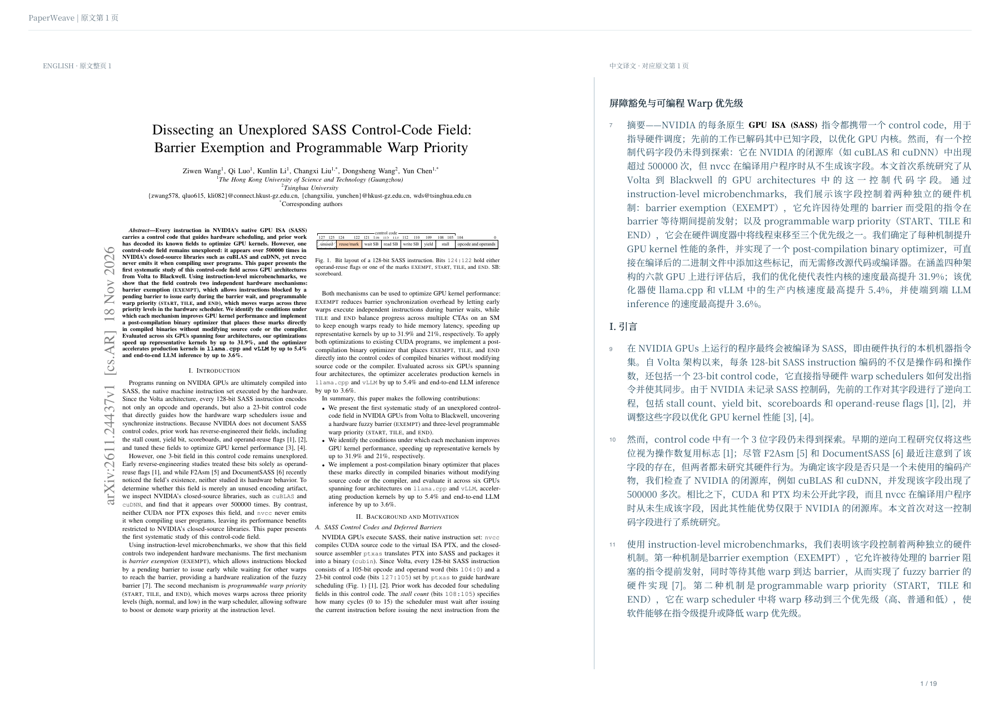

# [Plugin][Zotero 10] PaperWeave: editable English–Chinese PDFs (early alpha)

I am sharing **PaperWeave**, an independent open-source Zotero 10 plugin for reading English papers with an editable Chinese translation.

It creates a new PDF attachment with the intact original page on the left (60%) and Chinese on the right (40%). Translations are grouped by source page and paragraph; longer translations continue onto additional pages with the source page repeated. This is not line-by-line coordinate alignment.

To try it:

1. Download the XPI from the [alpha.35 release](https://github.com/alan-hpc/zotero-paper-weave/releases/tag/v0.1.0-alpha.35), install it through Zotero's Tools → Plugins menu, and restart Zotero.
2. Select a paper or PDF attachment, open PaperWeave from the context menu, and save your model settings.
3. Translate and generate the PDF. Reopen the workbench to correct a paragraph, save the revision, and rebuild using the cached translations.

Paper-specific terminology can stay in English. Figures, captions, tables and formulas retain their original appearance in the translated column; detected author details remain only on the intact source page. The new attachment becomes the preferred PDF for its parent paper while the plugin is enabled, and the original is retained.

You can use DeepSeek, another compatible Chat Completions endpoint, or an optional local helper for the official Codex CLI with ChatGPT login. Use DeepSeek alone, or enable multiple services and arrange their priority from top to bottom, with optional fallback on explicit quota exhaustion. Model requests send paper text to your chosen service and may incur costs. The plugin does not upload PDF files or images and has no author-hosted translation service.

**This is an early alpha.** Type checks, offline regressions and a cached-paper PDF rebuild pass. Earlier builds received limited macOS/Zotero 10 checks, but the alpha.35 package has not completed in-app installation acceptance, and other platforms are unverified. Layout and math detection need review. Scans require OCR; encrypted or rotated pages are unsupported. Old PDF annotations do not migrate; local revision projects need separate backup. Alpha updates are manual.

[Source and instructions](https://github.com/alan-hpc/zotero-paper-weave) · [Privacy](https://github.com/alan-hpc/zotero-paper-weave/blob/main/docs/PRIVACY.md) · [Issues](https://github.com/alan-hpc/zotero-paper-weave/issues)

Feedback on layout, formulas, and installation is welcome. Please include your OS, Zotero version, and a public sample PDF where possible. This project is unaffiliated with Zotero.
