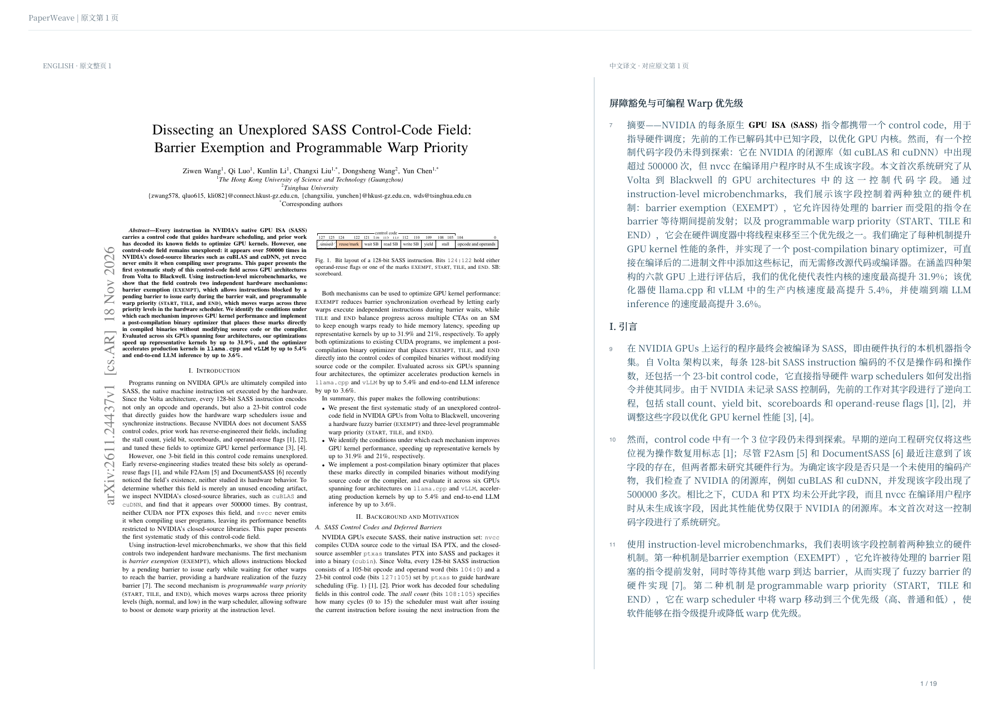

# [早期试用] PaperWeave：可修订的 Zotero 英中对照 PDF 插件

大家好，我开源了 **PaperWeave · 论文织译**，适用于 Zotero 10。它把英文论文生成左侧完整原页 60%、右侧中文 40% 的新 PDF 附件；译文按原文页和段落组织，较长时增加续页，并重复显示对应原页。

## 怎么用

1. 在 [alpha.35 发布页](https://github.com/alan-hpc/zotero-paper-weave/releases/tag/v0.1.0-alpha.35)下载 XPI，通过 Zotero「工具 → 插件 → 齿轮 → 从文件安装插件」安装并重启。
2. 选中论文或 PDF，右键打开 PaperWeave，填写模型设置并保存。
3. 点击「翻译并生成 PDF」。译文不准确时，回到工作台修改段落、保存修订，再生成；已有译文会复用缓存。

技术术语逐篇识别，也可手工修改词表。图表、图注、表格和公式保留原貌，放入右栏对应位置；作者信息仅保留在左侧。新 PDF 默认成为父论文优先打开的附件，原附件仍保留。

支持 DeepSeek、兼容的 Chat Completions 接口，以及可选的本机 Codex 代理。可以只用 DeepSeek，也可启用多个服务，按从上到下的优先级调用，明确额度耗尽时按需切到下一项。模型调用会向所选服务发送论文文本，并可能计费；插件不上传 PDF 文件或图片，没有作者托管的翻译服务。

## 当前状态

这是 **0.1.0-alpha.35 早期预览版**，适合愿意反馈问题的试用者。类型检查、离线回归和缓存论文重排已通过。早期版本在 macOS / Zotero 10 做过少量实际检查；**alpha.35 安装包尚未在 Zotero 内完成安装验收，其他平台尚未验证。**

版面、图表边界和数学识别仍可能出错，需对照原文复核。扫描件需先 OCR，加密或旋转页暂不支持。旧 PDF 批注不会自动迁移，修订项目在本机保存，需自行导出备份。Alpha 更新需手动安装。

[源码与使用说明](https://github.com/alan-hpc/zotero-paper-weave) · [隐私说明](https://github.com/alan-hpc/zotero-paper-weave/blob/main/docs/PRIVACY.md) · [反馈问题](https://github.com/alan-hpc/zotero-paper-weave/issues)

欢迎反馈安装、版面和公式问题，请尽量附上系统、Zotero 版本及可公开的示例论文。项目独立开发，与 Zotero 官方无隶属关系。
