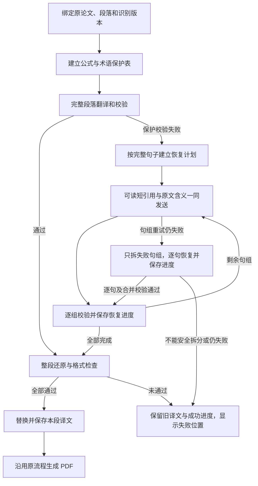

# 翻译保护、错误恢复与验收方案

> alpha.49：启用主按钮下方的自动检查后，不再等待人工核对。以下逐句保护校验继续执行；有限重译和图片复查仍失败的内容明确保存为来源绑定的原文保留区域，在 PDF 对应位置展示，旧中文留在项目中。网络、额度、登录、磁盘和生成故障不转换为原文保留。详见 [自动处理规则](VISION.zh-CN.md)。

适用于 0.1.0-alpha.48。本方案处理反复出现的保护项缺失、重复、损坏和恢复失败，不改变 PDF 导出入口或放宽识别校验。

## 为什么图片识别成功后还会失败

识别和翻译是两个独立阶段。识别正确，不代表后续翻译会完整保留公式、术语及加粗。

ReplaySSM 的 b47、b96 已采用图片识别，分别包含 28、37 个保护项。旧流程让模型在翻译长段落时复制较长的内部标记；模型偶尔漏掉一个，三轮修复仍可能失败。重复图片识别并不能修好这类译文错误。

DistMoE b232 则在可读短引用恢复时重复写了一个损失公式引用。原文中多处相同公式仍是不同出现位置，模型不能复用同一引用，或为了补全代词而增加公式。alpha.48 将失败句组进一步按完整句子恢复，保留原文含义与中文语序，仍核对全部出现次数。

处理时需要分别判断：

| 阶段 | 判定依据 | 处理方式 |
| --- | --- | --- |
| 原文结构 | 分段、坐标、正文/图表/算法归属 | 先修复原文范围；图表和算法整组保留 |
| 图片识别 | 数字、公式、范围、模型报告的疑问 | 核对截图和识别原文，确认后采用 |
| 译文保护 | 保护项缺失、重复、未知项、加粗不完整 | 使用来源绑定恢复，保留已采用的识别 |
| 服务请求 | 网络、登录、临时限速、额度 | 有限重试；仅明确额度耗尽按已配置顺序切换 |
| 保存与输出 | 源论文绑定、完整性、字体及版面 | 保存成功后继续；失败不覆盖旧译文或原 PDF |

## 统一处理流程

### 1. 先检查识别输入，再绑定保护项

同栏正文的源坐标用于补足少取的行末范围，不扩展到相邻栏，也不改写原始坐标。截图缓存绑定实际裁切范围。图片识别第 3 版明确允许页边续句和公式前后的可见片段，并区分正文引用图号与真正图表。旧版未解决的识别会使用修复后的截图重试；已采用及人工修订的结果保留。

公式、显式 LaTeX、代码、术语和原文字面标记仍使用独立的扁平保护表。每项绑定原论文身份、指纹、当前段落及原文，数学引用和加粗范围在还原时计算，不能把其他论文或其他句组的标记混进来。

恢复请求使用 `<r0/>` 这样的短引用，同时提供该引用代表的真实原文。模型翻译完整句子，可按中文语序移动引用；插件按来源还原原文内容。这样既降低复制复杂标记的负担，也让模型知道每个引用的含义。

没有采用固定英文顺序的中文拼接：这会造成公式和修饰语错配。最终采用的方式保留完整句子的自然翻译和引用重排能力。

### 2. 每一层都进行校验

- 请求发出前：保护表扁平、每项出现一次、加粗结构完整。
- 每个恢复句组：只允许本组的原文保护项；拒绝漏项、重复项、其他段落标记和损坏引用。
- 本地还原前：检查原文字面值的展开是否有唯一对应，拒绝额外复制保护内容；不通过猜测或补到段末修复。
- 整段合并后：再次检查所有保护项、加粗范围和公式来源引用。
- PDF 生成前：沿用当前需复核段落的拦截。识别仍有疑问时等待核对。

这些检查验证结构和来源完整性，不能代替语义审阅。验收时还需要对照真实译文检查公式修饰关系和正文含义。

### 3. 恢复进度与正式译文分开保存

恢复中的句组保存在单独的 `translationRecovery` 记录中。原文、段落 ID、坐标和旧译文不改写；只有整段全部通过，才更新正式译文并清除恢复记录。

失败句组的逐句进度作为该记录的内层检查点保存，单独绑定父句组、完整源句和配置。已有成功句组不重译；恢复时先校验并保留已成功的句子，避免在回放前清空中间进度。新译文整段通过后才替换旧译文，同时清除两层恢复记录。

恢复记录绑定论文键值与指纹、段落、坐标、识别版本、保护表、格式、模型配置、补充偏好和提示版本。重启后先核对绑定，并重新校验缓存句组；绑定改变或内容损坏时不复用。

取消、网络失败或后续句组失败时，已保存的句组继续保留。下一次从未完成部分继续，避免反复重译整段。每个句组也保留实际模型来源；跨服务完成的段落会记录所用模型。

### 4. 错误显示具体阶段和位置

已采用图片识别的段落若发生译文保护错误，会说明“图片识别已采用”，并显示失败的第几句组、具体缺失/重复引用及已保存进度。该情形无需重新上传截图。

逐句恢复失败会显示父句组与句子的位置，例如“第 1/2 句组的第 3/5 句”，以及已经保存的句组、句子数量。重复引用按实际重复数量报告，不再统一计入未知项。

原文尚未修复时，已勾选的图片识别仍可用于修复原文；不会在同一次任务中对相同识别结果反复执行相同的修复循环。

### 5. 请求有明确上限

正常整段保护校验最多尝试三个响应。仍失败时，恢复计划最多八个句组，每组最多两个响应，每组最多 64 个保护项。某组仍失败时，仅该组最多细分为 32 个完整句子，每句最多两个响应；已记录失败位置或逐句进度时直接从相应层继续，不重复已失败的大句组。句子、公式、代码、括号或加粗范围不会被机械截断。无法安全划分时保留失败状态，等待原文分段复核。

网络重试沿用原有上限；取消会停止后续请求。段落并发数继续沿用现有设置，句组不会再额外增加一层并发。恢复复用现有 Chat Completions 接口和代理，不需要另配 Key 或启动新服务。

## 验收与回归

回归覆盖：

- 原有七类保护错误，以及短引用缺失、重复、损坏、外来引用和未知引用。
- 重复术语、重复公式、公式身份、中文重排、加粗、代码、列表和 Unicode。
- 完整句子划分、缩写及括号边界，以及无法安全拆分的长内容。
- 句组保存、重启继续、跨论文失效、取消、部分失败和旧译文不变。
- 失败句组局部细分、逐句检查点、保留已完成句子后重启、模型变化失效、嵌套记录校验和取消后不保存新结果。
- 已采用识别的复用、普通限速与额度切换的区分，以及未完成时的 PDF 拦截。

ReplaySSM 的 b47、b96 使用真实 `gpt-6-luna` 验证了来源绑定恢复和译文含义：分别分为 3、4 个句组，全部保护项通过校验；b96 的一个句组经过一次内容修复。验证在项目副本中进行，不改写原 Zotero 缓存。离线检查和项目副本检查不代表已经在 Zotero 内完成新版安装验收。

追加的整篇项目副本验收覆盖了 7 个截图边界、跨页和区域类型问题：真实图片识别全部通过，后续翻译完成，当前自动复核项归零；按原流程生成完整验证 PDF，没有用原文段落回退替代未完成译文。此过程未改写 Zotero 原项目。

alpha.48 在 DistMoE 项目副本中使用当前本机 Codex 的 `gpt-6-luna` 验证 b232：失败的第 1 组分成 5 个完整句子，第 2 组一次完成，共 6 次文字请求；4 处损失公式和其他保护项均通过，其他 312 段保留。该段已生成无原文回退的 PDF 排版验证副本。整篇还有其他待复核项，此结果不等于完整论文已在 Zotero 导出；原缓存未写入。
